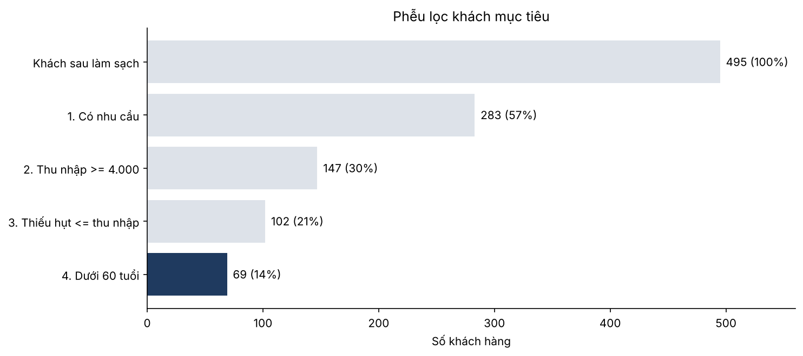
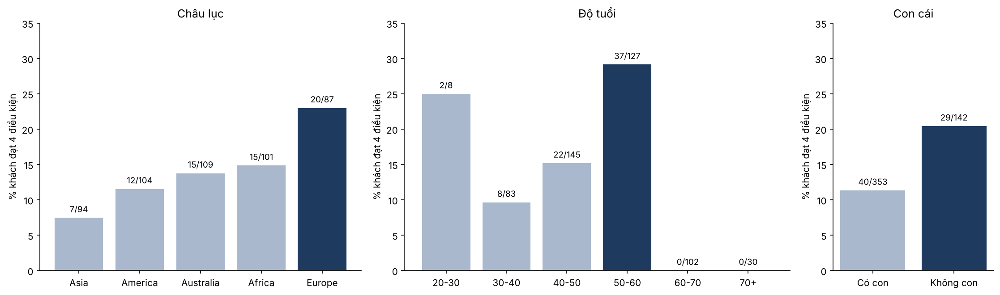

# Data Bank: ai nên được mời mở thẻ tín dụng? (SQL case study)

**Báo cáo đầy đủ:** [report/Data_Bank_Credit_Card_Report.pdf](report/Data_Bank_Credit_Card_Report.pdf)
**Code SQL Server:** [sql/](sql/)
**Notebook chạy lại trên Colab:** [credit_card_targeting.ipynb](credit_card_targeting.ipynb)

## 1. Bài toán

CEO muốn đẩy mạnh cho vay khách hàng cá nhân. Ngân hàng đã có nhiều khách dùng thẻ thanh toán, nhưng số lượng và dư nợ thẻ tín dụng còn thấp. Thẻ tín dụng là bậc đầu tiên của sản phẩm cho vay (thẻ thanh toán → thẻ tín dụng → vay mua xe → vay mua nhà), nên ngân hàng muốn chuyển khách thẻ thanh toán sang thẻ tín dụng.

**Câu hỏi:** trong số khách đang dùng tài khoản thanh toán, ai vừa **cần** tín dụng, vừa **trả được** nợ?

## 2. Logic giải quyết

| Tiêu chí | Ý nghĩa | Điều kiện SQL |
|---|---|---|
| 1. Có nhu cầu | Tiền ra (rút + chi tiêu) nhiều hơn tiền nạp vào mỗi tháng | `net_flow < 0` |
| 2. Thu nhập đủ | Thu nhập gần hoặc trên trung vị ngân hàng (4.230 USD/tháng) | `monthly_income >= 4000` |
| 3. Trả được | Phần thiếu hụt không vượt quá 1 tháng thu nhập | `-net_flow <= monthly_income` |
| 4. Còn bán chéo | Còn thời gian để mời vay mua xe, mua nhà | `age < 60` |

Quy trình 5 bước: xác định vấn đề → thu thập dữ liệu → làm sạch → phân tích 5 chiều (châu lục, độ tuổi, học vấn, hôn nhân, số con) → lọc từng khách và đề xuất.

## 3. Công cụ

- **SQL Server (T-SQL):** kiểm tra và làm sạch dữ liệu, JOIN 4 bảng, tính dòng tiền theo tháng (CTE, `EOMONTH`, `CASE WHEN`), tổng hợp theo nhóm (`GROUP BY`, `UNION ALL`), xuất danh sách khách.
- **Python + DuckDB:** chạy lại cùng logic SQL trên Google Colab (không cần cài server) và vẽ biểu đồ bằng matplotlib.

## 4. Kết quả chính

- **57% khách (283/495) tiêu nhiều hơn số tiền nạp vào.** Nhu cầu tín dụng rất rộng; câu hỏi khó hơn là ai trả được nợ.
- **Nhu cầu và khả năng trả đi ngược nhau.** Khách có con thiếu tiền nhiều hơn, nhưng thu nhập chỉ khoảng 3.800 USD/tháng so với 5.420 USD của khách không con.
- **Chọn theo trung bình nhóm dễ chọn sai.** 3 nhóm "thiếu tiền nhất" (châu Phi 40–50 có con, châu Úc 40–50 có con, châu Á 30–40 có con) có 67 khách nhưng chỉ **7 khách** đủ điều kiện, vì họ thiếu tiền chính do thu nhập thấp.
- **Lọc theo từng khách: 69 khách (14%)** đạt cả 4 điều kiện, thu nhập TB 5.980 USD/tháng, thiếu hụt TB 3.090 USD/tháng (tổng khoảng 213 nghìn USD/tháng).
- **Châu Âu (23%) và nhóm 50–60 tuổi (29%)** có tỷ lệ khách mục tiêu cao nhất.




## 5. Hành động đề xuất

1. Mời 69 khách trong [output/target_customers.csv](output/target_customers.csv) mở thẻ tín dụng, ưu tiên châu Âu, châu Phi, châu Úc và nhóm 50–60 tuổi.
2. Chạy thử có nhóm đối chứng: chỉ mời một nửa danh sách, so sánh tỷ lệ mở thẻ và chi tiêu sau 3 tháng trước khi mở rộng.
3. Chưa mời 136 khách thâm hụt có thu nhập dưới 4.000 USD hoặc thiếu dữ liệu thu nhập; cập nhật thu nhập và kiểm tra lịch sử tín dụng trước.
4. Theo dõi: tỷ lệ mở thẻ, tỷ lệ kích hoạt, dư nợ trung bình, tỷ lệ trả chậm trên 30 ngày, số khách chuyển sang vay mua xe, mua nhà sau 12 tháng.

## 6. Dữ liệu và làm sạch

4 bảng: `customer_info` (700 khách), `customer_region`, `regions`, `customer_transactions` (5.868 giao dịch, 01/01–28/04/2020). Nguồn: khóa học Ứng dụng SQL trong Tài chính.

Các vấn đề đã xử lý: `2n Cycle` → Master, `Alone` → Single, loại 5 khách mở thẻ khi trên 70 tuổi (gồm năm sinh 1893/1899/1900), loại 200 khách không có giao dịch, `region_id = 6` không có tên châu lục, thu nhập = 0 chuyển thành NULL, 20 nhóm hồ sơ trùng được ghi chú. Sau làm sạch còn **495 khách, 5.798 giao dịch**.

## 7. Cấu trúc thư mục

```
sql/
  01_create_tables.sql      tạo database, bảng, nạp CSV
  02_data_check.sql         kiểm tra format, outlier, NULL, khóa nối bảng
  03_clean.sql              customer_clean, transactions_clean
  04_cashflow.sql           dòng tiền vào/ra theo tháng của từng khách
  05_segment_analysis.sql   phân tích 5 chiều
  06_target_customers.sql   lọc 4 điều kiện, xuất danh sách khách
credit_card_targeting.ipynb cùng logic, chạy bằng DuckDB, có biểu đồ
data/                       4 file CSV
output/                     target_customers.csv, segment_summary.csv
figures/                    biểu đồ
report/                     báo cáo PDF
```

## 8. Cách chạy

- **SQL Server:** chạy lần lượt các file trong `sql/` (sửa đường dẫn CSV trong `01_create_tables.sql`, hoặc dùng Import Flat File).
- **Google Colab:** mở notebook, bấm Run all, tải lên 4 file trong `data/` khi được hỏi.
- **Máy cá nhân:** `pip install -r requirements.txt`, rồi mở notebook từ thư mục gốc của repo.

## Hạn chế

Chỉ có 4 tháng giao dịch (tháng 4 chưa đủ tháng); chưa có lịch sử tín dụng, khoản nợ hiện có hay thu nhập đã xác minh. Ngưỡng 4.000 USD và 60 tuổi là giả định; ngân hàng thật sẽ lấy theo chính sách cấp tín dụng.
